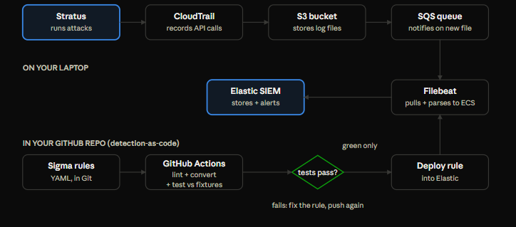
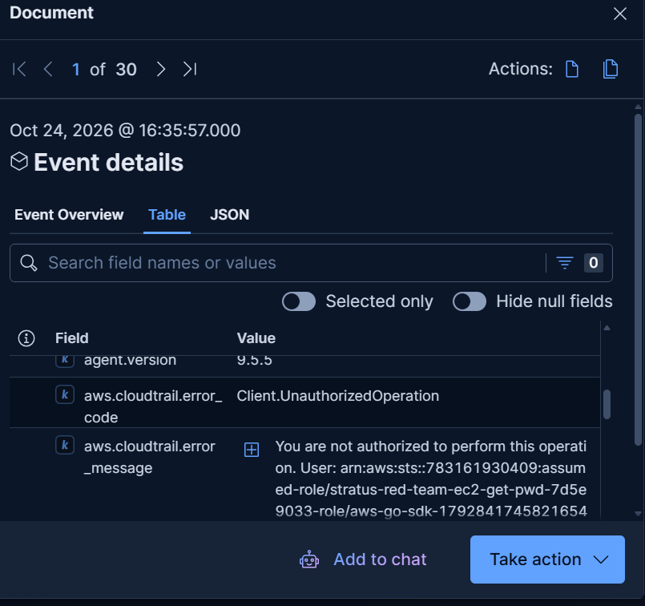

# Cloud Detection Lab

 A cloud detection lab that catches real AWS attacks, like disabling CloudTrail and stealing EC2 passwords, in an Elastic SIEM. Proven by running live attack techniques with Stratus Red Team and finding every one in the logs.

## How it works

AWS API call → CloudTrail → S3 → SQS → Filebeat → Elasticsearch → Kibana (Elastic SIEM)

[architecture diagram screenshot]

Attacks are run with Stratus Red Team against a dedicated lab account. Detection rules are
written in Sigma and will be tested in CI before they deploy (Week 3).

## Design decisions

- **Multi-Region trail.** IAM and STS events are recorded in us-east-1, so a single-Region
  trail in Sydney would miss every IAM attack (backdoor users, access keys, role changes).
- **SQS with 14-day retention.** Filebeat reads new-file notifications from a queue instead of
  rescanning the bucket. If Filebeat is stopped or my session expires, messages wait. No gaps.
- **Separate role for Filebeat.** Least privilege: it can only consume one queue and read
  CloudTrail log files in one bucket folder. A compromise of the collector can't touch anything else.
- **Seccomp kept on.** Filebeat parses untrusted data. If a malicious log ever exploited it,
  seccomp stops the attacker from launching a shell. I fixed credentials instead of disabling it.
- **No access keys anywhere.** I use `aws login` for temporary `ASIA` credentials that expire
  on their own. Filebeat reads the login session natively and assumes its limited role.
- **Idempotent infra scripts.** Re-running them changes nothing unless something is missing or
  has drifted, so re-runs don't trip my own log-tampering detections, and drift gets reported.

## Detections so far

| Activity | What CloudTrail showed |
| --- | --- |
| Attempt to stop CloudTrail logging, using the Filebeat role | `StopLogging`, denied with `AccessDenied` |
| `ec2-get-password-data` (Stratus) | 30 `GetPasswordData` calls in 9 seconds from a new role, all denied with `Client.UnauthorizedOperation` |

[GetPasswordData screenshot, account ID blurred]

## Reproduce it

See [`infra/README.md`](infra/README.md) for the setup scripts.

## Build journal

What broke and how I fixed it: [`journal.md`](journal.md)

## Status

Week 1 done: pipeline and first attack. Next: Sigma rules for the attack plan.